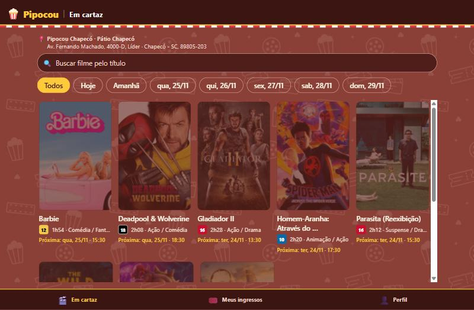
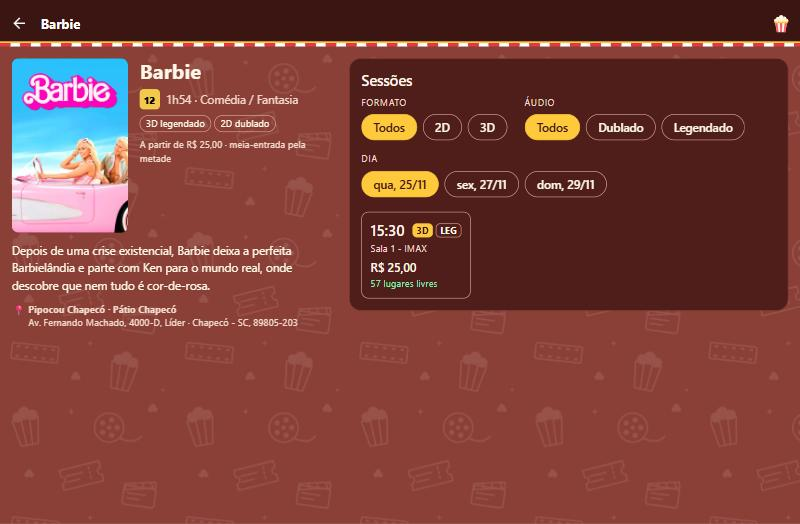
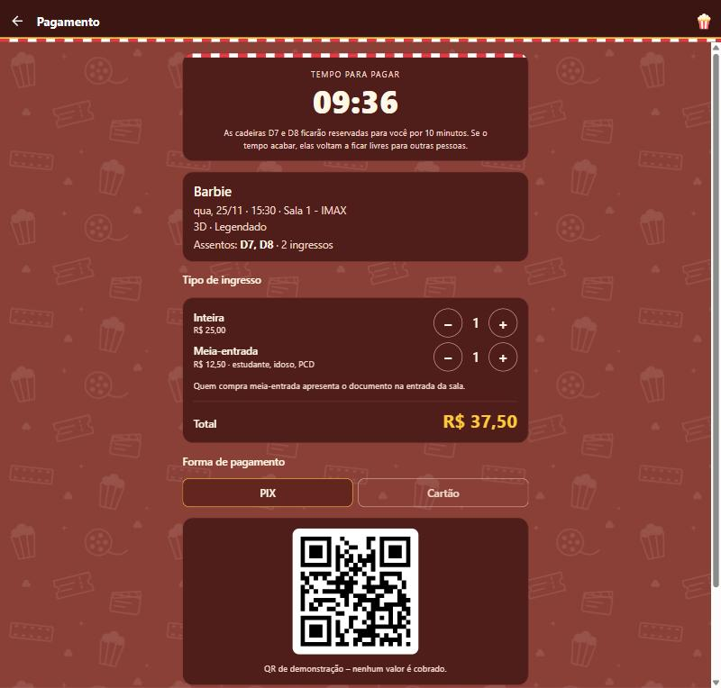
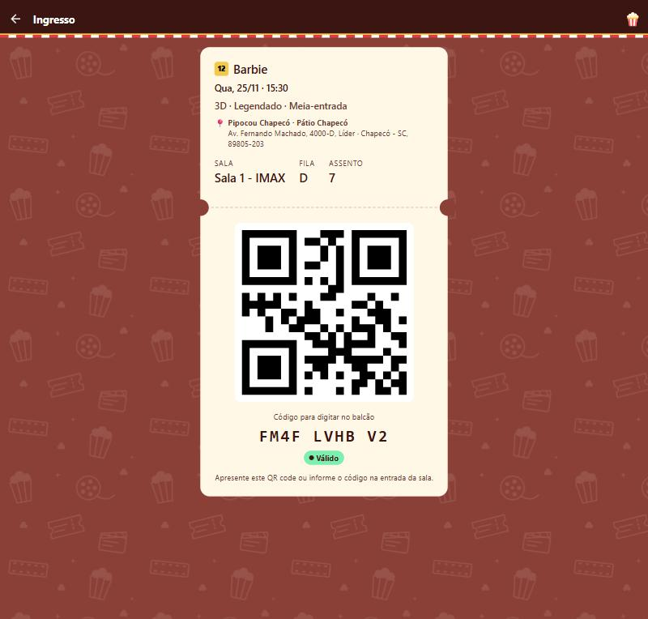
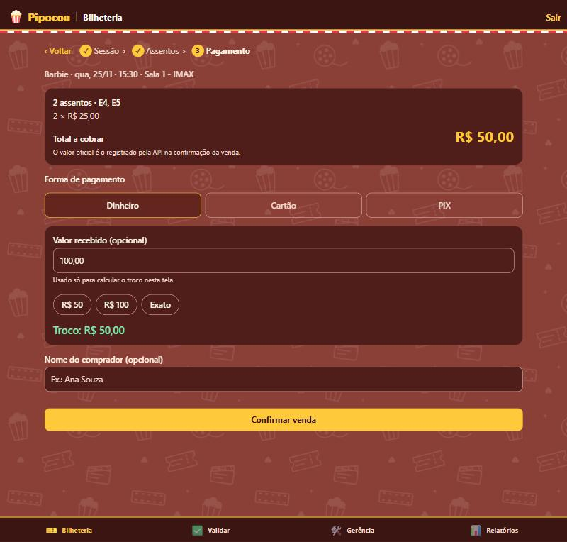
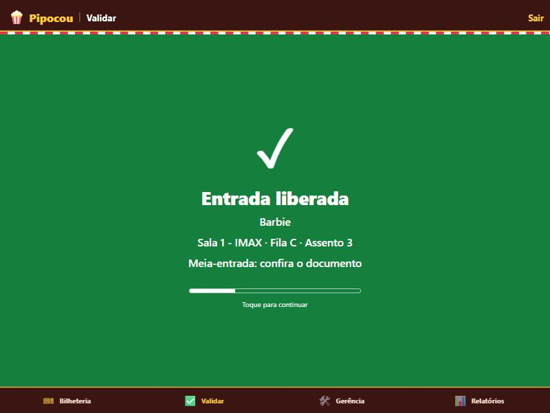
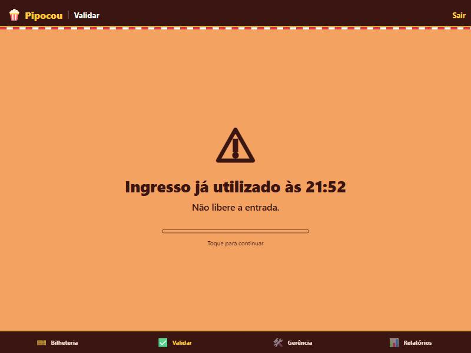
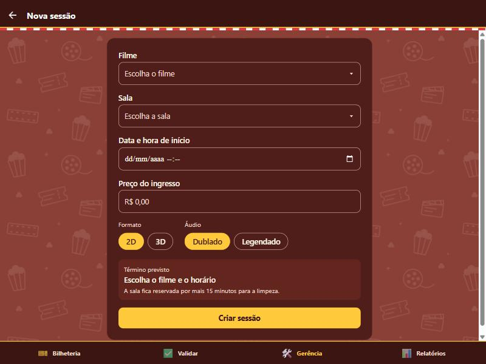
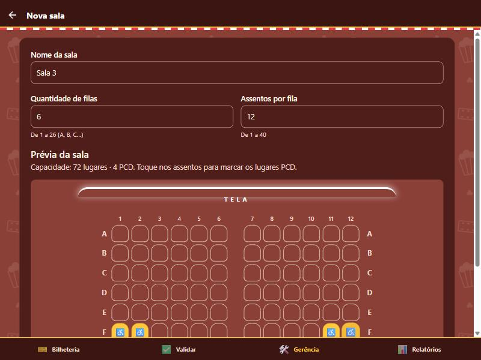
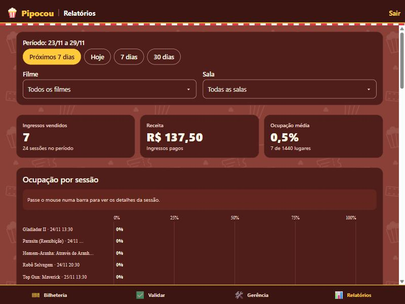

# 🍿 Pipocou

> **Teu lugar, tua pipoca, tua sessão.**

App de cinema com **marcação de assentos**: Trabalho Final de Programação II + Banco de Dados II (Unoesc).
O cliente escolhe o lugar no mapa, reserva, paga (pagamento simulado) e recebe o ingresso com QR code. O operador vende no balcão, valida a entrada, cadastra filmes, salas e sessões e acompanha os relatórios.

- **App em produção:** [pipocou.163.176.53.31.sslip.io](https://pipocou.163.176.53.31.sslip.io) (HTTPS, VM Oracle Cloud em São Paulo)
- **API (backend):** [bilheteria-api](https://github.com/Isacosta412/bilheteria_api), no mesmo endereço, em `https://pipocou.163.176.53.31.sslip.io/api` ([healthcheck](https://pipocou.163.176.53.31.sslip.io/api/health))
- **Cinema:** Pipocou Chapecó, no Pátio Chapecó (Av. Fernando Machado, 4000-D, Líder, Chapecó - SC). O endereço aparece em Em cartaz, na página do filme e no ingresso ([`src/lib/cinema.ts`](src/lib/cinema.ts)).

**Stack:** Expo (SDK 58) + React Native + TypeScript strict, Expo Router, React Query, react-hook-form + zod, axios, react-native-svg / react-native-qrcode-svg, react-native-reanimated, expo-camera.
Alvos: **Web** (usado na apresentação) e Android/iOS pelo Expo Go.

## Identidade

| | |
|---|---|
| Nome | **Pipocou** (a aba de venda do operador continua se chamando **Bilheteria**) |
| Slogan | "Teu lugar, tua pipoca, tua sessão." (login e cadastro) |
| Bordão da compra | "Escolheu, pipocou, sentou." (pagamento aprovado e "Meus ingressos" vazio) |
| Logo | balde de pipoca em SVG: [`src/components/LogoPipocou.tsx`](src/components/LogoPipocou.tsx) e [`assets/icon-pipocou.svg`](assets/icon-pipocou.svg) |

**Paleta** ([`src/theme/cores.ts`](src/theme/cores.ts), contraste WCAG AA medido em cada par): sala de cinema, com fundo vinho/terracota, cartões em vinho escuro, pipoca amarela e o vermelho e branco do balde.

| Papel | Cor | Uso |
|---|---|---|
| Fundo | `#8A3F37` | fundo das telas, com a estampa de baldes, rolos de filme, claquetes e ingressos ([`FundoCinema.tsx`](src/components/FundoCinema.tsx)) |
| Superfície | `#4F1D1A` | cartões e painéis |
| Barra | `#3A1512` | cabeçalho e abas, com a faixa listrada vermelho/branco |
| Primária | `#FFC93C` | botões, seleção, destaques (texto sobre ela: `#3A1512`, 9,0:1) |
| Vermelho do balde | `#E63946` | faixa listrada, logo, "TELA" do mapa |
| Texto | `#FFF8E7` | texto principal (7,0:1 no fundo; 13,0:1 nos cartões) |

Mapa de assentos (cor **e** ícone, nunca só cor): livre = contorno creme · selecionado = amarelo com ✓ · reservado = laranja `#F4A261` com relógio · vendido = `#6B5550` com ✕ · PCD com ♿ · "TELA" no topo.

Os ícones do app (`assets/images/*.png`) saem do mesmo desenho do logo:

```bash
node scripts/gerar-icones.mjs
```

O script usa o Chrome ou o Edge em modo headless, sem dependência nova.

### Animações
- **Cortina de comemoração** ([`CortinaPipoca.tsx`](src/components/CortinaPipoca.tsx)), no login e no pagamento aprovado: a tela escurece em vinho, o balde aparece, treme e estoura em pipocas com o texto ("Pipocou! 🍿" ou "Pagamento aprovado! 🍿"). Com tudo coberto, a próxima tela entra por baixo e a cortina se abre.
- **Balcão:** sem animação, para não atrasar a fila.

As partículas usam [`ExplosaoPipoca.tsx`](src/components/ExplosaoPipoca.tsx) (reanimated + svg), no UI thread, sem setState por quadro. Com **"reduzir movimento"** ligado no sistema, só o texto aparece, com fade.

## Funcionalidades

**Cliente**
- **Em cartaz:** busca por título e filtro por dia; só aparecem filmes com sessão.
- **Página do filme:** em tela larga, filme à esquerda e sessões à direita, numa tela só. Filtros de **formato (2D/3D)**, **áudio (dublado/legendado)** e **dia**; cada sessão mostra os selos `3D`/`2D` e `DUB`/`LEG`.
- **Mapa de assentos:** atualiza a cada 5 s; se outra pessoa pegar o assento, aparece "Ops! Alguém acabou de escolher um desses assentos". A quantidade de ingressos é a quantidade de assentos marcados.
- **Pagamento:** contagem regressiva da reserva, escolha de **inteira e meia-entrada** (botões − e +; meia = metade do preço) e total calculado pela API. PIX ou cartão (simulados).
- **Ingresso:** QR code, código de 10 caracteres, versão (ex.: "3D · Legendado") e se é inteira ou meia.

**Operador**
- **Bilheteria:** venda no balcão (sessão → assentos → pagamento em dinheiro, cartão ou PIX), com troco e impressão.
- **Validar:** código digitado ou QR lido pela câmera. Verde = entrada liberada (com aviso "Meia-entrada: confira o documento"); laranja = já utilizado.
- **Gerência:** filmes, salas (com prévia e marcação de PCD) e sessões (filme e sala escolhidos pelo nome, formato e áudio).
- **Relatórios:** "Próximos 7 dias" (padrão), hoje, 7 ou 30 dias; ingressos, receita, ocupação, gráfico por sessão, tabela ordenável com CSV e vendas App × Balcão. A receita soma o valor pago em cada ingresso.

## Telas

Prints tirados com dados de teste, em `docs/prints/`.

| Cliente | |
|---|---|
|  |  |
| Em cartaz, com o endereço do cinema e o filtro por dia | Página do filme numa tela só, com 2D/3D, áudio e dia |
|  |  |
| Mapa de assentos (atualiza a cada 5 s) | Pagamento com contagem regressiva e inteira/meia |
|  | |
| Ingresso com QR code, versão e meia-entrada | |

| Operador | |
|---|---|
|  |  |
| Venda no balcão com troco | Entrada liberada (meia: confira o documento) |
|  |  |
| O mesmo código de novo: já utilizado | Nova sessão com formato e áudio |
|  |  |
| Nova sala com prévia e lugares PCD | Relatórios: ocupação, receita, App × Balcão |

## Contas de demonstração

| Perfil | E-mail | Senha |
|---|---|---|
| Operador | `operador@pipocou.com` | `operador123` |
| Cliente | `cliente@pipocou.com` | `cliente123` |

Em desenvolvimento, o operador é criado pelo `npm run seed` do backend (e-mail e senha vêm do `.env` dele: `SEED_OPERADOR_*`). Clientes podem se cadastrar pela tela "Cadastre-se".

## Como rodar (desenvolvimento)

Pré-requisitos: Node.js 20+ e a API rodando (veja o README do backend).

```bash
npm install
```

```bash
cp .env.example .env
```

```bash
npm run web
```

O app abre em http://localhost:8081. No PowerShell, troque o `cp` por `Copy-Item .env.example .env`.

**Para ver as animações:** entre com uma conta de cliente (a cortina do login aparece antes do catálogo). Depois escolha uma sessão, reserve assentos e toque em "Já paguei" (a cortina do pagamento aprovado). Uma conta nova mostra o "Meus ingressos" vazio com o bordão.

### Variáveis de ambiente

| Variável | Exemplo | Para quê |
|---|---|---|
| `EXPO_PUBLIC_API_URL` | `http://localhost:3333` | Endereço da API. Vai junto no código do app: **nunca coloque segredos** em variáveis `EXPO_PUBLIC_*`. |

Valores comuns: web e emulador iOS no mesmo computador → `http://localhost:3333`; emulador Android → `http://10.0.2.2:3333`; celular na mesma rede → `http://<IP-do-computador>:3333`.
A origem do app (ex.: `http://localhost:8081`) precisa estar no `CORS_ORIGIN` do backend.

### Scripts

| Script | O que faz |
|---|---|
| `npm run web` | Expo na web (porta 8081) |
| `npm start` | Expo Dev Server (Expo Go no celular) |
| `npm run build:web` | `expo export --platform web` → pasta `dist/` (site estático) |
| `npm run typecheck` | `tsc --noEmit` (strict) |
| `npm run lint` | ESLint (`expo lint`) |

## Celular

### Expo Go (mais simples)
1. Instale o **Expo Go** (Android ou iOS).
2. No `.env`, aponte `EXPO_PUBLIC_API_URL` para uma API que o celular alcance: a URL de produção ou `http://<IP-do-computador>:3333`.
3. Rode o comando abaixo e leia o QR code com o Expo Go (Android) ou com a câmera (iOS):

```bash
npx expo start --tunnel
```

O `--tunnel` funciona mesmo quando o celular e o computador estão em redes diferentes. Na mesma rede Wi-Fi, `npx expo start` basta.

### APK com EAS Build (opcional)
O perfil `preview` do [`eas.json`](eas.json) gera um APK para instalar direto no Android.
1. Troque `EXPO_PUBLIC_API_URL` no `eas.json` pela URL da API de produção (`https://pipocou.163.176.53.31.sslip.io/api`).
2. Rode os comandos abaixo (precisa de uma conta Expo gratuita; o build roda na nuvem da Expo):

```bash
npx eas-cli login
```

```bash
npx eas-cli build --platform android --profile preview
```

Ao terminar, o EAS mostra o link para baixar o APK.

## Produção (um subdomínio só)

O app e a API ficam no mesmo endereço, numa VM com Nginx:

| Caminho | O que é |
|---|---|
| `https://pipocou.163.176.53.31.sslip.io/` | o app web (arquivos estáticos em `/srv/app`) |
| `https://pipocou.163.176.53.31.sslip.io/api/...` | a API (o Nginx repassa para `127.0.0.1:3333`) |

Como os dois estão na mesma origem, o navegador não faz chamadas entre origens e o CORS não atrapalha. Nenhuma rota do app pode se chamar `api` (não há `app/api*`).

**`.env.production`** (não versionado; o `npx expo export` lê ele sozinho). Como app e API estão no mesmo endereço, o caminho relativo basta:

```
EXPO_PUBLIC_API_URL=/api
```

**Publicar** com o [`deploy-web.ps1`](deploy-web.ps1):
1. O topo do script já vem com o servidor do projeto (`163.176.53.31`, `pipocou.163.176.53.31.sslip.io`) e procura a chave em `$HOME\.ssh\bilheteria.pem`: copie para lá a `bilheteria.pem` de `acesso_servidor_oracle`.
2. Na pasta do app, rode o script. Ele gera o `dist/` com `npx expo export --platform web`, usando `https://$Dominio/api`, e envia tudo por `scp` para `ubuntu@IP:/srv/app`.

```powershell
.\deploy-web.ps1
```

Para apagar os arquivos antigos do servidor antes do envio, use `-Limpar`:

```powershell
.\deploy-web.ps1 -Limpar
```

**Nginx** (trecho do `server` do subdomínio; o HTTPS pode vir do Certbot):

```nginx
root /srv/app;
index index.html;

# Fallback de SPA: qualquer rota (ex.: /gerencia/filmes) abre o index.html e o Expo Router resolve a tela.
location / {
    try_files $uri $uri/ /index.html;
}

# A barra no fim do proxy_pass tira o "/api" antes de chegar na API (o backend não muda).
location /api/ {
    proxy_pass http://127.0.0.1:3333/;
    proxy_set_header Host $host;
    proxy_set_header X-Forwarded-For $proxy_add_x_forwarded_for;
    proxy_set_header X-Forwarded-Proto $scheme;
}
```

Na VM, antes do primeiro envio, deixe a pasta com o usuário `ubuntu`:

```bash
sudo mkdir -p /srv/app && sudo chown ubuntu:ubuntu /srv/app
```

Para testar o build no seu computador do mesmo jeito que o Nginx serve (com fallback de SPA), rode estes dois comandos e abra http://localhost:5173/gerencia/filmes:

```bash
npx expo export --platform web
```

```bash
node scripts/servir-dist.mjs dist
```

**CI:** o workflow [`.github/workflows/ci.yml`](.github/workflows/ci.yml) roda a cada push na `main`. Ele checa os tipos, roda o lint e gera o build web. Não publica nada: a publicação é pelo `deploy-web.ps1`.

## Estrutura

```
app/                      rotas (Expo Router)
  _layout.tsx             providers (React Query, Auth), carregamento e tela de erro amigável (ErrorBoundary)
  (publico)/              login, cadastro                       → só sem login
  (cliente)/              catálogo, mapa, pagamento, ingressos  → só CLIENTE
  (operador)/             balcão, validar, gerência, relatórios → só OPERADOR
src/
  api/        cliente axios (token, 401 → logout), traduzirErro, dicionário de erros, um arquivo por recurso
  components/ LogoPipocou, ExplosaoPipoca, Botao, Campo, MapaAssentos, Toast, Dialogo, formulários, relatórios…
  contexts/   AuthProvider (usuário, entrar, cadastrar, sair; restaura a sessão com GET /auth/me)
  hooks/      useAuth, useMapaAssentos, useSelecaoAssentos, useContagemRegressiva…
  lib/        armazenamento (SecureStore no celular, localStorage na web), rotas, formatação, dinheiro
  schemas/    schemas zod dos formulários
  theme/      paleta Pipocou (contraste AA), espaçamentos, tipografia
  types/      tipos que espelham os DTOs da API
```

**Proteção por papel:** cada grupo confere o papel no próprio `_layout.tsx` e manda o usuário para a tela inicial do seu papel (`src/lib/rotas.ts`). Um cliente que digita `/relatorios` na web volta para `/`. A API recusa de qualquer jeito; esta é a camada de interface.

**Erros:** a tela nunca mostra JSON, stack trace nem token. `traduzirErro(e)` converte o `erro.codigo` da API em uma mensagem em português (`src/api/erros.ts`), e um erro inesperado de tela cai no `ErrorBoundary` com "Tentar de novo".
